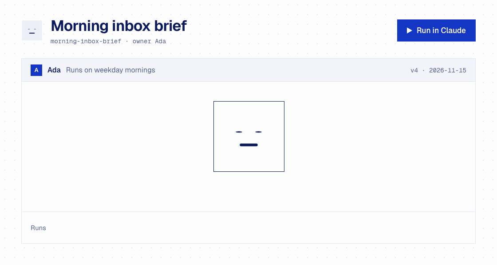

<p align="center"></p>

<h1 align="center">Harness Hub</h1>

<p align="center">Save an agent's harness once. Your teammates run it with their own agent and their own accounts.</p>

<p align="center">
  <a href="LICENSE"></a>
  
  
  
  
  
  
  
  
  <a href="CONTRIBUTING.md#a-map-of-the-code-optional"></a>
</p>

<p align="center"></p>

## What it is

A **harness** is everything that makes an agent run: its goal, its prompt, and its skills, tools,
hooks and memory. Harness Hub is the team's shared library of them.

- **Built from pieces.** Each skill, tool, hook and memory is a piece with its own versions. Any
  harness can use any piece, and always gets its latest version.
- **Versions, suggestions and copies.** Every save is a new version. Teammates suggest changes or
  make their own copy.
- **Private or team.** A new harness or piece is private until you share it with the team.
- **Your own values.** Save your handle, links or time zone for a harness once: your runs fill
  them in, and nobody else sees them.
- **Safe runs.** An agent never posts, sends, pays or deletes for you without your go. Left alone
  on a schedule, it only updates the one place you named for the harness, such as your artifact.
- **Runs report back.** At the end of a run, the agent reports how it went and on which model.
  Each harness shows where it worked, by model and agent, next to the models its owner says it
  works well on. The Stats page sums it up.
- **Works beyond Claude.** Tried with Claude and ChatGPT: same harness, same rules, both report
  their runs.
- **Your agent does it, the website shows it.** Saving, sharing, archiving, editors, marking runs
  and adding teammates all happen by asking your agent.
- **Text only.** The Hub never runs anything and never holds anyone's credentials.

## How it fits together

<p align="center"></p>

## How to use it

1. **Connect your agent.** In Claude, add a custom connector at your Hub's address followed by
   `/api/mcp` and sign in with an allowed Google account. If
   the connector is already installed for your team, click Connect. Any agent that supports remote
   MCP servers with sign-in can connect the same way. In ChatGPT: Plugins → Add → "Add a custom MCP
   server", with the same address. **Connect an agent** in the dashboard has the steps, and lets you
   make each connected agent read-only. In Claude, a new chat picks up the Hub's newest tools.
2. **Run a harness.** Say to your agent:
   > Run the harness morning-inbox-brief from Harness Hub.

   Or pick it from the connector's prompts, where your agent shows them, with a field for each
   variable.
3. **Save your values.** Say yes when your agent offers to save them. Later runs stop asking.
4. **Schedule it.** Say "Schedule the harness morning-inbox-brief from Harness Hub". Your agent
   tells you the days and time it will use (the ones the harness is meant to run at, when its
   owner set them) and creates the task in your own agent on your yes.
5. **Save your own.** Ask your agent to save a harness or a skill to Harness Hub. It stays private
   until you ask to share it.
6. **Everything else, just ask.** "Share it with the team", "Set works well on to Claude; gpt-6
   in ChatGPT", "Make my teammate an editor", "I looked at that failed run, mark it dealt with".
   In Claude, each change asks for your click first.

## Run your own Hub

[](https://vercel.com/new/clone?repository-url=https%3A%2F%2Fgithub.com%2FSamBagetAI%2Fharness-hub-oss&project-name=harness-hub&repository-name=harness-hub&env=HUB_URL%2CALLOWED_EMAILS%2CNEXT_PUBLIC_CLERK_PUBLISHABLE_KEY%2CCLERK_SECRET_KEY&envDescription=The%20Hub%27s%20public%20address%20%28for%20example%20https%3A%2F%2Fyour-project.vercel.app%29%2C%20the%20admins%27%20Google%20addresses%2C%20and%20the%20keys%20of%20your%20Clerk%20application.&envLink=https%3A%2F%2Fgithub.com%2FSamBagetAI%2Fharness-hub-oss%2Fblob%2Fmain%2Fdocs%2Fhow-it-works.md%23run-your-own-hub&stores=%5B%7B%22type%22%3A%22integration%22%2C%22integrationSlug%22%3A%22neon%22%2C%22productSlug%22%3A%22neon%22%2C%22protocol%22%3A%22storage%22%7D%5D)

Your own Hub runs on Vercel, with a Neon database and a Clerk application for sign-in. The button
copies the code, creates the project and adds the database; Clerk you set up yourself. It takes
about half an hour: the steps are in [Run your own Hub](docs/how-it-works.md#run-your-own-hub).

## Run it locally

```bash
pnpm install
cp .env.example .env.local   # fill in the values
pnpm dev                     # http://localhost:3210
pnpm test                    # unit tests, no database needed
```

The rules, the environment variables and the checks are in
[docs/how-it-works.md](docs/how-it-works.md).

## Contributing

Issues and pull requests are welcome: see [CONTRIBUTING.md](CONTRIBUTING.md). To report a security
problem, see [SECURITY.md](SECURITY.md).

## License

[MIT](LICENSE).
